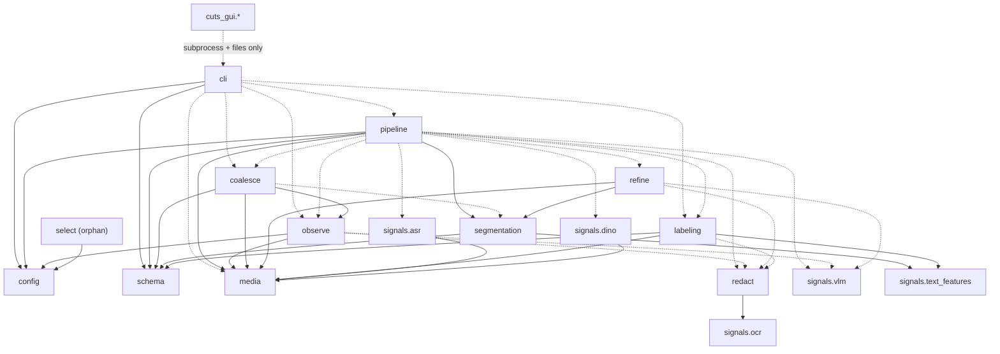

# 01 — Overview: layout, dependencies, entry points

## 1. Repository layout

### Tracked source (what `git ls-files` returns)

```
cuts/                      backend package (≈ 7.0k lines)
  __init__.py              re-exports CutsConfig only
  __main__.py              `python -m cuts` -> cli.main()
  cli.py            524    argparse CLI: chapters / probe / observe / coalesce / label
  config.py         515    every tunable, as nested dataclasses under CutsConfig
  pipeline.py       700    orchestrator: run() -> _run_llm() or the curve path
  media.py          728    PyAV decoding, seeking, Timeline/Source, image resize
  observe.py        524    Pass 1: shard planning, observe_shard, JSONL cache
  coalesce.py       493    Pass 2: one Claude call -> cut points + titles, validation
  refine.py         156    single-bisection boundary refinement
  redact.py         254    credential regexes, black-box fill, scrub_frame()
  segmentation.py   525    EFS Stage 1: similarity curve, minima, merge, min-duration
  labeling.py       545    chapter titles (Claude or heuristic)
  select.py         249    EFS Stages 2-3 (query-driven frame selection) — never called
  schema.py         270    Event dataclass, events.json read/write, chapter-list text
  signals/
    __init__.py
    vlm.py          444    Claude vision descriptions + refinement classifier call
    ocr.py          230    RapidOCR wrapper with boxes mapped back to frame coords
    asr.py          142    faster-whisper transcription + alignment to sample times
    dino.py         194    DINOv2 CLS embeddings (curve path only)
    text_features.py 106   TF-IDF matrices (curve path only)
cuts_gui/                  desktop front end (≈ 4.4k lines), never imports `cuts`
  app.py, __main__.py      QApplication bootstrap
  backend.py        539    the ONLY module that knows the CLI and file formats
  jobs.py           261    QProcess job queue (one run at a time)
  model.py          259    GUI-side dataclasses (Index, Chapter, Note, Session)
  library.py        109    persisted list of sessions (library.json)
  window.py         984    MainWindow wiring
  panels.py         878    Library / Chapters / Notes / Run panels
  timeline.py       615    custom-painted multi-lane timeline
  dialogs.py        603    add/analyze/re-chapter/settings dialogs, Preferences
  player.py         172    QMediaPlayer over a multi-file timeline
  thumbs.py         125    async thumbnail service (2 threads, LRU 800)
  media.py          116    GUI-side PyAV probe + single-frame grab
  theme.py          191    palette + stylesheet
pyproject.toml, requirements.txt, README.md, .gitignore
```

There is **no test suite** in the repository (no `tests/`, no `test_*.py`),
even though the README's "Status" section describes validation runs. Each
module instead has an `if __name__ == "__main__":` debug entry point
(`python -m cuts.<module> <video>`).

### Untracked / ignored material in the working tree

These are present on disk but are not part of the current system. Nothing in
`cuts/` or `cuts_gui/` reads them.

| Path | Size | What it is |
|------|------|-----------|
| `OmniShotCut/` | 53 MB | Third-party shot-boundary model code (`architecture/`, `test_code/inference.py`, `app.py`). Removed from the pipeline in commit `84a4a9c` ("Remove AutoShot/OmniShotCut arms"). |
| `checkpoints/OmniShotCut_ckpt.pth` | 157 MB | Weights for the above (ignored by `*.pth` in `.gitignore`). |
| `retrieval_index/(1) setting up thoughts/` | 407 MB | `bm25.pkl`, `text_emb.npy`, `segments.json`, `frames/`, `ocr_debug/` — output of a removed text-search feature. Its only trace in code is the unused `SearchConfig` (`cuts/config.py:449`). |
| `refine_experiment/thumbnails/` | 6 MB | PNGs named `boundary_NNN_coarse_*.png` — an earlier refinement experiment. |
| `dummy.json` | 83 B | `{"video_path": ..., "cuts": []}` — the output format of the pre-pivot shot-detection tool. |
| `cuts.egg-info/` | — | Stale build metadata from April; its `requires.txt` lists `scenedetect`, `scikit-image`, `pandas`, `matplotlib`, none of which the code uses. |
| `.venv/` | — | Local virtualenv (see §3). |

## 2. Declared dependencies

`pyproject.toml` and `requirements.txt` declare the same unpinned set:

| Package | Used by | Required? |
|---------|---------|-----------|
| `av` (PyAV) | `cuts/media.py`, `cuts_gui/media.py` | Always |
| `numpy`, `opencv-python`, `pillow` | everywhere / resize, JPEG, rectangles / `select.py` only | Always (pillow only by `select`) |
| `torch`, `torchvision`, `transformers` | `signals/dino.py` | Curve path only (lazy import) |
| `rapidocr-onnxruntime` | `signals/ocr.py` | Whenever OCR is enabled (default) |
| `faster-whisper` | `signals/asr.py` | When a source has audio and ASR is on; `ImportError` is tolerated |
| `anthropic` | `signals/vlm.py`, `coalesce.py`, `labeling.py` | Imported lazily; failures are caught (see [08](08-llm-integration.md)) |
| `python-dotenv` | `cli.py:_load_dotenv` | Optional; `ImportError` is tolerated |

Not declared anywhere but imported:

- **`PySide6`** (all of `cuts_gui`). `pyproject.toml`'s package discovery
  (`include = ["cuts*"]`) *does* match `cuts_gui`, so the GUI is packaged but
  its dependency is not declared and it has no console-script entry.
- **`open_clip`** (`cuts/select.py`) — commented out in `requirements.txt`;
  harmless because `select.py` is never imported.

`pyproject.toml` declares only one script: `cuts = "cuts.cli:main"`.

## 3. Runtime environment as observed

The README requires Python 3.12 ("3.13 lacks wheels for `ctranslate2`").
The local `.venv` in this working tree was checked read-only and differs:

- Python **3.14.6** (`.venv/pyvenv.cfg` says 3.14.3 at creation).
- PyAV **17.0.1**, which **has no `av.AVError`** attribute (`FFmpegError`
  exists). The code catches `av.AVError` in three places — see
  [11-findings.md §1.3](11-findings.md#13-avaverror-no-longer-exists-in-the-installed-pyav).
- `anthropic`, `python-dotenv` and `PySide6` are **not installed**. In this
  venv every Claude call therefore fails (and is swallowed), and the GUI
  cannot start.
- Installed extras not in `requirements.txt`: `open_clip_torch`,
  `sentence_transformers` (leftovers from the removed search feature).

None of this is a code defect by itself, but it means "works on my machine"
results described in the README were not produced from this venv.

## 4. Entry points

| Command | Function | Notes |
|---------|----------|-------|
| `python -m cuts chapters <video...>` | `cuts/cli.py:265` `cmd_chapters` | Full run. Calls `pipeline.run`. |
| `python -m cuts probe <video...>` | `cuts/cli.py:220` `cmd_probe` | Metadata + a runtime estimate (the estimate formula is stale; see findings). |
| `python -m cuts observe <video...>` | `cuts/cli.py:310` `cmd_observe` | Pass 1 only, honours the cache. |
| `python -m cuts coalesce <obs.jsonl>` | `cuts/cli.py:352` `cmd_coalesce` | Pass 2 only over a cache. No ASR, no refinement, no fallback. |
| `python -m cuts label <events.json>` | `cuts/cli.py:421` `cmd_label` | Re-title an existing index. |
| `python -m cuts_gui [paths]` | `cuts_gui/app.py:15` `main` | Desktop app; spawns the CLI. |
| `python -m cuts.<module> ...` | each module's `__main__` block | Debug harnesses for single stages. |

`cli.main` (`cuts/cli.py:469`) first calls `_load_dotenv()`
(`cuts/cli.py:453`), which loads the first `.env` found walking upward from
the **current working directory** with `override=False`. The GUI sets the
subprocess cwd to the backend root for this reason (`cuts_gui/backend.py:55`).

## 5. Module dependency graph

Solid arrows are module-level imports; dashed arrows are lazy imports inside
functions (the codebase uses lazy imports heavily so that torch, ONNX,
Whisper and the Anthropic SDK are only loaded on the paths that need them).



Notable couplings:

- `coalesce` imports the private `segmentation._enforce_min_duration`
  (`cuts/coalesce.py:305`), and `pipeline` imports the private
  `coalesce._dedup` / `_pick_representative_times`
  (`cuts/pipeline.py:628`) and `labeling._pick_representative`
  (`cuts/pipeline.py:699`). `refine` depends on
  `segmentation.SegmentationInput` even on the LLM path, which builds a
  synthetic one (`cuts/pipeline.py:546`).
- `cli.cmd_coalesce` imports the private `pipeline._attach_sources`
  (`cuts/cli.py:399`).
- `select.py` has no inbound edges at all.

## 6. Configuration surface in one table

All defaults live in `cuts/config.py`. The CLI mutates a fresh `CutsConfig`
per command; nothing reads a config file.

| Knob | Default | CLI flag | Honoured by |
|------|---------|----------|-------------|
| `segmenter` | `"llm"` | `--segmenter` | `pipeline.run` |
| `sampling.sample_interval_sec` | 30 | `--interval` | both paths |
| `observe.shard_sec` / `workers` / `executor` / `seek` / `cache` | 300 / cpu_count / thread / True / True | `--shard-sec` `--workers` `--executor` `--no-seek` `--no-cache` | LLM path |
| `vlm.model` | `claude-haiku-4-5` | `--vlm-model` | both |
| `vlm.enabled` | True | `--no-vlm` | both |
| `vlm.stride` | 1 | `--vlm-stride` | curve path only |
| `vlm.frames_per_call` / `concurrency` / `max_inflight_chunks` | 6 / 6 / 12 | — | `max_inflight_chunks` curve only |
| `ocr.enabled` / `upscale_factor` / `max_chars` | True / 2 / 1000 | — | both |
| `redact.enabled` | True | `--no-redact` | both + labeling |
| `asr.enabled` / `model` | True / `base` | `--no-asr` | both |
| `coalesce.model` / `effort` / `max_tokens` | `claude-opus-5` / medium / 16000 | `--coalesce-model` | LLM path |
| `coalesce.intent` / `include_ocr` | "" / False | `--intent` `--include-ocr` | LLM path |
| `segmentation.min_event_sec` | 20 | `--min-chapter` | both (validation in LLM path) |
| `segmentation.target_events` | None (4 min/event, clamp 3–24) | `--chapters` | curve only |
| `segmentation.weight_dino/vlm/asr` | 0.5 / 0.5 / 0.0 | `--no-dino` | curve only |
| `refine.enabled` | True | `--no-refine` | both |
| `labeling.enabled` / `model` | True / `claude-opus-5` | `--no-labels` (also disables coalesce!) | curve + fallback + `label` |
| `labeling.batch_all_events` | True | — | **never read** |
| `select.*`, `search.*`, `cache_dir` | — | — | **never used** by any reachable code |
