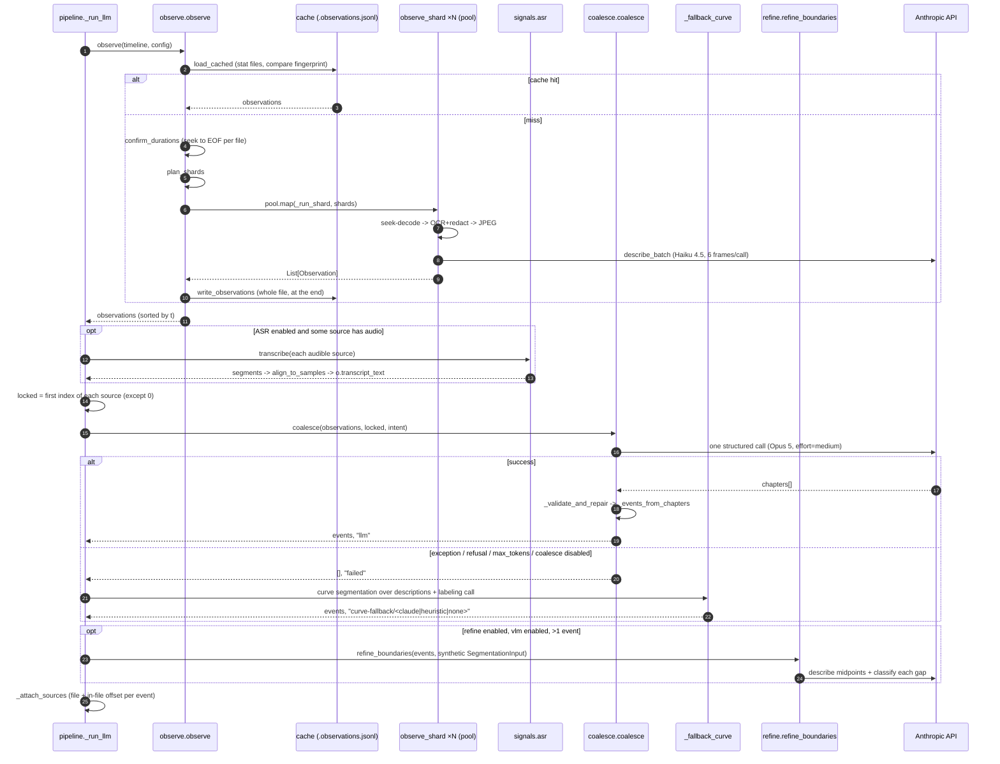
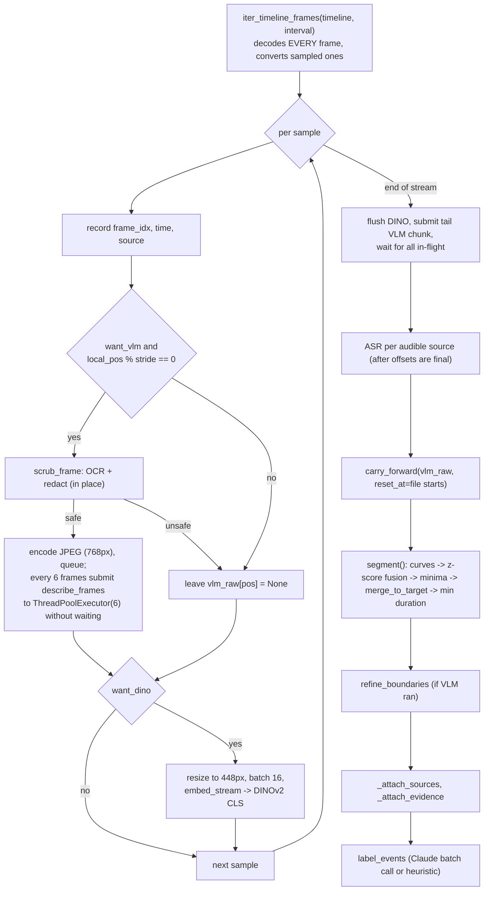

# 02 — Execution paths, end to end

This document follows each command from argv to the files it writes. Stage
internals are covered in later documents; here the focus is control flow,
what feeds what, and which branches exist.

## 1. `chapters`: the dispatch

```
cli.main                      cuts/cli.py:469
 └─ cmd_chapters              cuts/cli.py:265
     ├─ _resolve_videos       absolute paths, exit 2 on the first missing file
     ├─ _config_from_args     cuts/cli.py:173 -> CutsConfig
     ├─ pipeline.run(videos, cfg, label_backend=args.backend,
     │               join_boundaries=not args.no_join_boundaries)   cuts/pipeline.py:88
     │    ├─ Timeline.build(paths)          header durations only     cuts/media.py:357
     │    ├─ video_id = first stem (+N)                                cuts/pipeline.py:81
     │    ├─ if config.segmenter == "llm":  return _run_llm(...)       cuts/pipeline.py:116
     │    └─ else: curve path (inline in run)                          cuts/pipeline.py:120-451
     └─ write_events(out_path, ...)         atomic temp+rename         cuts/schema.py:179
         prints chapter list + summary; last line "index: <path>" (the GUI parses this)
```

`out_path` defaults to `<first_stem>.events.json` beside the first video, or
`<first_stem>+N.events.json` for N extra files (`cuts/cli.py:207`). The
`extra` block of the index records `n_samples`, `channels`, `segmenter`,
`intent`, `label_backend` and `stage_times` (`cuts/cli.py:284`).

If `result.events` is empty the command prints an error and exits 1 without
writing anything (`cuts/cli.py:274`).

## 2. The LLM path (default)

`_run_llm` at `cuts/pipeline.py:454`.



Step details and the branches that matter:

1. **Pass 1** — `observe()` (`cuts/observe.py:464`). The cache check runs
   *before* `confirm_durations`, so a cache hit leaves the `Timeline` with
   container-header durations. That has consequences for multi-file inputs;
   see [11-findings.md §1.5](11-findings.md#15-cache-hits-skip-duration-confirmation-so-offsets-can-disagree-with-cached-observations).
   An empty result short-circuits to a `PipelineResult` with no events
   (`cuts/pipeline.py:485`), which `cmd_chapters` reports as an error.
2. **ASR** — runs on every invocation, cached or not
   (`cuts/pipeline.py:496-513`). Transcripts are attached to the in-memory
   observations *after* the cache was written, so they are never cached.
3. **Locked boundaries** — the first observation of each source except the
   first (`cuts/pipeline.py:517-523`); empty with `--no-join-boundaries`.
4. **Pass 2** — `coalesce()` (`cuts/coalesce.py:407`), or `([], "failed")`
   if `config.coalesce.enabled` is False. Note that `--no-labels` sets
   `coalesce.enabled = False` (`cuts/cli.py:185-187`), so `--no-labels`
   on the LLM path *always* takes the fallback branch and prints
   "coalescing failed".
5. **Fallback** — `_fallback_curve` (`cuts/pipeline.py:580`) copies the
   segmentation config with `weight_dino = 0`, builds a `SegmentationInput`
   whose "frame indices" are observation positions, runs
   `segmentation.segment` with `forced_bounds=locked`, re-attaches
   observation evidence, and calls `label_events(..., backend="auto")`
   (ignoring the user's `--backend`). See [06](06-curve-path-labeling-asr.md).
6. **Refinement** — runs if `refine.enabled and vlm.enabled and len(events) > 1`
   (`cuts/pipeline.py:543`). It needs a `SegmentationInput` only for its
   `times` list, so one is synthesised with `frame_indices=range(n)`.
   Locked positions are excluded. See [05](05-pass2-coalesce-refine.md#7-boundary-refinement).
7. **Sources** — `_attach_sources` (`cuts/pipeline.py:646`) maps each
   event's (possibly refined) `start_time` through `Timeline.local_time`.

`PipelineResult.label_backend` on this path is the *segmenter outcome*
(`"llm"` or `"curve-fallback/..."`), not a labeling backend
(`cuts/pipeline.py:570`). `channels_used` is `["vlm"]` whenever
`vlm.enabled`, regardless of whether any description actually succeeded,
plus `"asr"` if any transcript text exists.

## 3. The curve path (`--segmenter curve`)

Inline in `run()` from `cuts/pipeline.py:120` to `:451`. Unlike the LLM path
it makes a **single sequential streaming pass** over every frame of every
file and extracts all per-sample signals inside that loop.



Branch conditions worth knowing:

- `want_vlm = vlm.enabled and weight_vlm > 0` **and** an API key is visible
  in `api_key` or `ANTHROPIC_API_KEY` (`cuts/pipeline.py:134-139`). Only
  this path checks credentials up front; note it ignores the SDK's other
  credential sources (`ant auth login` profiles), so a profile-only setup
  disables the VLM channel here even though the SDK could authenticate.
- `want_ocr_grounding = want_vlm and ocr.enabled` — OCR and redaction run
  **only** on frames that will be described. The DINO branch then receives
  the already-redacted image (same ndarray).
- At a file join the pending VLM chunk is submitted early so one call never
  mixes recordings (`cuts/pipeline.py:239-251`), and `local_pos` resets so
  the first frame of each file is always described.
- Backpressure: after each submit, if more than `max_inflight_chunks` (12)
  futures are pending, the oldest is awaited (`cuts/pipeline.py:225-226`).
- Redaction tallies are printed unconditionally at the end
  (`cuts/pipeline.py:328-333`).
- If no samples were produced, returns an empty result
  (`cuts/pipeline.py:340-346`).
- Labeling uses `label_backend` from `--backend` (default `auto`).

## 4. `observe` (Pass 1 only)

`cmd_observe` (`cuts/cli.py:310`) builds a config from the observe flags
only, builds a `Timeline`, and calls `observe(timeline, cfg,
cache_path=out_path)`. Because it goes through `observe()` it both reads and
writes the cache. `-o` changes the cache path; a later `chapters` run will
**not** find a cache written to a non-default path, because `_run_llm` always
uses `observations_path(timeline.first_path)`.

No ASR runs here. The printed summary counts described vs. withheld
observations.

## 5. `coalesce` (Pass 2 only)

`cmd_coalesce` (`cuts/cli.py:352`):

1. `read_observations(path)` → `(observations, meta)`.
2. Rebuild a `Timeline` from `meta["files"]`, **keeping only files that
   still exist**, via `Timeline.build` (header durations, not confirmed
   ones). If none exist, `timeline = None` and duration is the last
   observation time.
3. Locked boundaries: first index of each `source_index` (except 0).
4. `coalesce(...)` with `video_id = <stem without .observations>`.
5. `_attach_sources` if a timeline exists.
6. `write_events(out_path, Path(out_path).stem, ...)` — note the `video_id`
   written is `"<stem>.events"` (the stem of `x.events.json`), not the
   `video_id` passed to `coalesce`, so `chapters` and `coalesce` write
   different `video_id`s for the same input.

What this path does **not** do, compared to `chapters`: no ASR (cached
observations never carry transcripts), no boundary refinement, no fallback
to the curve segmenter (a failed call exits 1 with "coalescing produced no
chapters"). The GUI's "Re-chapter" feature is this command.

## 6. `label`

`cmd_label` (`cuts/cli.py:421`) reads an `events.json`, rebuilds the
`Timeline` from its stored `sources`, calls `label_events` with the chosen
backend (default `auto`) and with OCR/redaction configs, and rewrites the
file in place. On an LLM-path index this **replaces** the titles the
coalescing call produced; `metadata.kind` and `summary` are left alone.
`write_events` is called without `extra`, so the `extra` block (segmenter,
intent, stage times) is **dropped** from the rewritten file.

## 7. `probe`

`cmd_probe` (`cuts/cli.py:220`) prints per-file metadata (no decoding) and
an estimate whose comment and formula assume the curve path
("decode is linear in total video length … ~4s/video-min for decode+DINO",
`cuts/cli.py:247-259`). On the default LLM path decoding is seek-based and
DINO never runs, so the estimate is not describing the default pipeline.

## 8. Path comparison

| Aspect | LLM path | Curve path | Fallback (LLM → curve) |
|--------|----------|-----------|------------------------|
| Decode strategy | Seek per sample, sharded | Sequential full decode | — (reuses observations) |
| Parallelism | Shards across a pool; VLM per shard | One decode loop; VLM via executor | — |
| OCR/redaction | Every decoded sample | Only samples that will be described | — |
| Visual embedding | none | DINOv2 CLS | none (`weight_dino=0`) |
| Boundary decision | One Opus call + validation | similarity minima + count budget | similarity minima over description TF-IDF |
| Chapter count | Model decides | `--chapters` or 4 min/event, clamped 3–24 | same as curve |
| Titles | Same call | `label_events` | `label_events(backend="auto")` |
| `kind` | `pivotal/active/routine/idle` | absent | absent |
| Cached intermediate | `observations.jsonl` | none | — |
| Deterministic | No | Yes (given same VLM text) | Yes given observations |
| Needs API for useful output | Yes | No (DINO-only + heuristic titles) | Mostly |

## 9. What happens without credentials

This differs between paths and is easy to get wrong, because the README and
the GUI both describe only the curve-path behaviour.

- **Curve path**: the VLM channel is skipped with a message; DINOv2 alone
  drives segmentation; labeling falls to the heuristic backend. Output is
  meaningful.
- **LLM path (default)**: nothing checks for credentials. Each
  `describe_frames` call fails inside its `try` and returns `""`
  (`cuts/signals/vlm.py:244-247`, logged only with `-v`). The empty
  descriptions **are written to the cache**. Coalescing then fails, the
  fallback builds a TF-IDF channel from empty strings, `build_channels`
  drops it (no tokens), and with no audio there are no channels at all, so
  `segment()` returns one event per source file
  (`cuts/segmentation.py:417-418`). Heuristic labels on empty text are
  `"unclear"`. Re-running later *with* a key reuses the poisoned cache
  unless `--no-cache` is given. See
  [11-findings.md §1.1–1.2](11-findings.md#11-transient-api-failures-are-cached-permanently).
