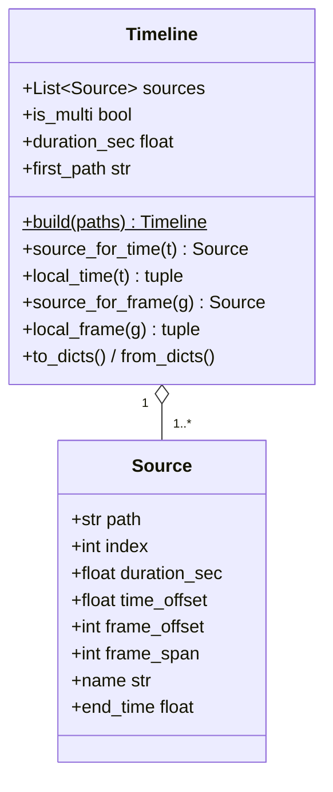

# 03 — Media: decoding, sampling, and the multi-file timeline

> **Pre-refactor.** This document describes the code at `c39a118`. The pipeline was since unified on branch `refactor/unify-pipeline`; see [12-unified-pipeline.md](12-unified-pipeline.md) for what changed.

All decoding goes through PyAV in `cuts/media.py`. The module's rule is that
timestamps are always `pts * time_base` (VFR-safe), never `frame_idx / fps`.
Images are `HxWx3` **BGR** `uint8` ndarrays (`frame.to_ndarray(format="bgr24")`)
so OpenCV calls need no conversion.

## 1. Primitives

| Function | Line | Strategy | Cost model | Used by |
|----------|------|----------|-----------|---------|
| `iter_sampled_frames(path, interval)` | `media.py:241` | Sequential decode of every frame; `to_ndarray` only on emitted ones. Emits first frame, then whenever `t >= last_emitted + interval`. | Linear in video length (decode of all frames) | curve path (via `iter_timeline_frames`), `--no-seek` fallback, debug mains |
| `iter_frames_at_times(path, times, tolerance=2.0, resume_window=10.0, search_frames=2000)` | `media.py:555` | One container open; for each sorted target either keep decoding (if within `resume_window` ahead of the current position) or seek backward to the keyframe and decode forward to the first frame `>= target`. | ~constant per sample regardless of depth (README reports ~0.08 s on 1080p) | Pass 1 shards, labeling (LLM-path events) |
| `decode_frame_near(path, t, search_frames=500)` | `media.py:514` | Seek + decode forward to first frame `>= t` (or give up after 500 frames and return *that* frame). | One GOP | refinement midpoints |
| `decode_frames_at(path, indices)` | `media.py:642` | Sequential decode up to the largest wanted index. | Linear up to the last index | labeling (curve-path events) |
| `true_duration_sec(path, hint)` | `media.py:180` | Seek to `hint - 5 s`, decode to EOF, return `max(hint, last_pts)`. | One GOP-ish | `observe.confirm_durations` |
| `get_duration_sec`, `probe_video`, `has_audio`, `get_fps` | `:162`, `:474`, `:221`, `:147` | Container metadata only | Instant | Timeline.build, probe, ASR gate; `get_fps` is unused |
| `build_frame_index(path, cache_dir)` | `:89` | Full decode, pickled cache keyed on path+mtime+size | Linear | **Unused** (no caller; `CutsConfig.cache_dir` is never passed) |
| `resize_long_edge(img, n)` | `:678` | `cv2.INTER_AREA` downscale, no-op if already small | — | everywhere |

### Seek details (`iter_frames_at_times`)

```text
targets = sorted(times)
for target in targets:
    if decoder is None or not (cur_t <= target <= cur_t + resume_window):
        container.seek(target / time_base, backward=True, any_frame=False)   # keyframe at or before
        decoder = container.decode(stream)
    pull frames until frame_t >= target  (or search_frames exhausted)
    if |frame_t - target| > tolerance: found = None
    if found is None: decoder = None   # force a fresh seek next time
    yield (target, found)
```

Properties:

- Always yields exactly one pair per requested time, in ascending order.
  `None` means "no frame within tolerance"; the usual cause is a request past
  the end of the stream.
- Returned frames have `frame_idx = -1`. Seek-based sampling deliberately
  assigns no ordinal; everything downstream on the LLM path keys on time.
- At the default 30 s interval with typical GOPs (~8 s) every sample
  re-seeks. The `resume_window` exists for a future dense "zoom" request.
- `container.seek` failure is caught as `av.AVError`, which **does not
  exist in the installed PyAV 17**; the `except` clause itself would raise
  `AttributeError`. See [11-findings.md §1.3](11-findings.md#13-avaverror-no-longer-exists-in-the-installed-pyav).

## 2. `Timeline` and `Source`



- `Timeline.build` (`media.py:357`) lays files end to end using **container
  header durations**, in the order given. A single file is a one-source
  timeline, so there is one code path.
- Global time = `source.time_offset + local time`. `local_time()` clamps:
  a time at or beyond the end maps to the last source
  (`media.py:403-417`).
- Frame offsets/spans are only meaningful after a sequential pass
  (`iter_timeline_frames`); on the LLM path they stay 0.

### Who finalises durations and offsets

There are two different mechanisms, and which one ran determines the
offsets that end up in `events.json`:

| Path | Mechanism | Where |
|------|-----------|-------|
| Curve | `iter_timeline_frames` sets each source's `time_offset`/`frame_offset` *while streaming*, then `duration = max(header, last sampled time)` | `media.py:427-471` |
| LLM, cache miss | `confirm_durations` seeks to the end of each file (`true_duration_sec`) and re-lays offsets **before** planning shards | `observe.py:175-190` |
| LLM, cache hit | **Nothing.** Header durations from `Timeline.build` are used as-is | `observe.py:476-481` |

Note also that on the curve path `duration = max(header, last *sampled*
time)` — the true end may lie up to one interval beyond the last sample but
before the header claim, so this only helps when the header under-reports by
more than the sampling gap.

## 3. Sampling grids

The two paths produce slightly different grids for the same file:

- **Curve** (`iter_sampled_frames`): first frame, then the first frame at or
  after `previous_emitted_t + interval`. Drift accumulates from actual frame
  times; samples land on real frame timestamps.
- **LLM** (`observe.plan_shards`, `observe.py:146`): `i * interval` for
  `i = 0 .. int(duration / interval)`, inclusive of `duration` within 1e-6.
  Observation `t` is the *requested* time (`shard.time_offset + local_t`),
  not the decoded frame's time (`observe.py:264-268`). Because
  `true_duration_sec` returns `max(header, last_frame_pts)`, the final grid
  point can lie past the last decodable frame; it then yields `None` and
  becomes a trailing `withheld` observation.

## 4. Memory behaviour

- Pass 1 holds, per shard, the full list of decoded frames for that shard
  (`frames = list(iter_frames_at_times(...))`, `observe.py:249`) — ~10
  full-resolution frames at the default 300 s / 30 s, i.e. ~60 MB at 1080p,
  multiplied by the number of concurrent workers. The local `frames` list
  keeps every decoded array referenced until `observe_shard` returns — i.e.
  through the network-bound `describe_batch` call as well — so peak memory
  is roughly (frames per shard × frame size) × workers for the whole
  duration of each shard's API calls.
- The curve path holds at most one DINO batch (16 resized frames) plus
  in-flight JPEGs bounded by `frames_per_call × max_inflight_chunks`
  (6 × 12 = 72).

## 5. GUI-side media

`cuts_gui/media.py` re-implements a metadata probe (`probe`, line 46) and a
single-frame grab (`grab_frame`, line 76) directly against PyAV so the GUI
never imports `cuts`. `grab_frame` catches seek errors with a bare
`except Exception`, so it is not affected by the `av.AVError` issue.
