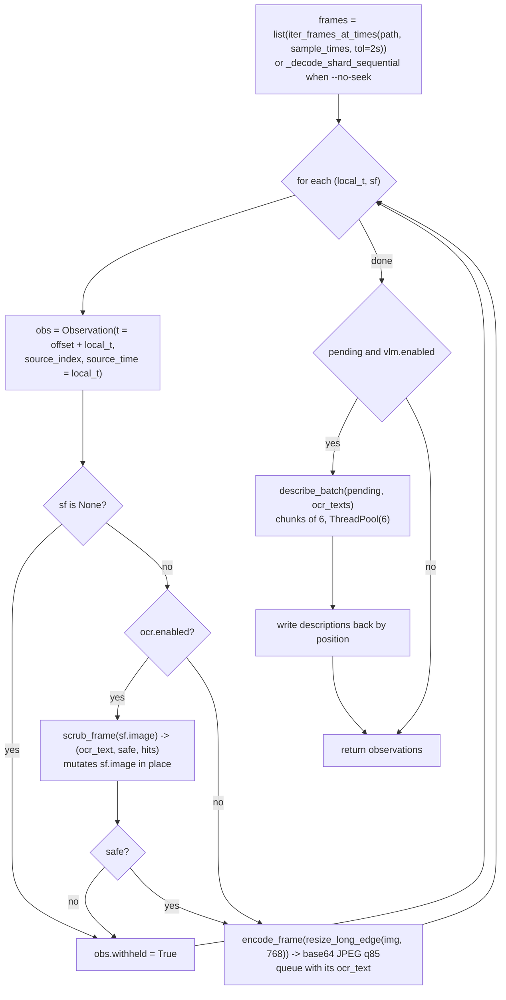
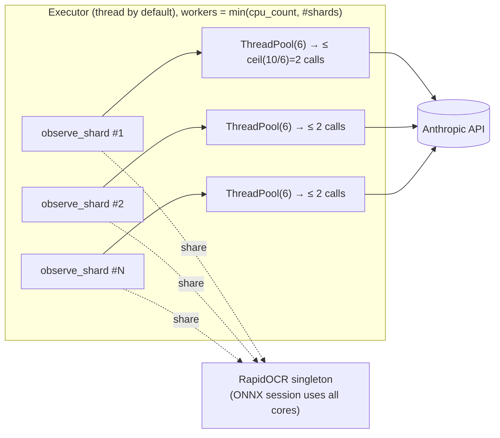

# 04 — Pass 1: observe (sharding, OCR, redaction, VLM descriptions, cache)

> **Pre-refactor.** This document describes the code at `c39a118`. The pipeline was since unified on branch `refactor/unify-pipeline`; see [12-unified-pipeline.md](12-unified-pipeline.md) for what changed.

Code: `cuts/observe.py`, `cuts/signals/ocr.py`, `cuts/redact.py`,
`cuts/signals/vlm.py`.

Pass 1 turns the timeline into a list of `Observation`s — one per sample —
and makes no decision about structure. It is the expensive half of a run and
is cached.

## 1. Control flow

```
observe(timeline, config, api_key, verbose, cache_path)        observe.py:464
├─ cache_path = <first_stem>.observations.jsonl (beside first video)
├─ load_cached(...) -> list | None                             observe.py:446
│     None if: cache disabled, file missing, unreadable JSON, empty,
│              or meta != _fingerprint(timeline, config)
├─ (hit)  print "[observe] reusing N cached observation(s)"; return
└─ (miss) observe_timeline(...)                                observe.py:317
      ├─ confirm_durations(timeline)        true end of every file
      ├─ plan_shards(timeline, interval, shard_sec)
      ├─ warn if redact on but OCR off
      ├─ workers = min(config.observe.workers or cpu_count, len(shards))
      ├─ serial | ThreadPoolExecutor | ProcessPoolExecutor .map(_run_shard)
      ├─ flatten, sort by t
      ├─ print "[redact] blacked out credentials in K frame(s) (...)" if any
      └─ return observations
   write_observations(cache_path, observations, _fingerprint(...))   (only if non-empty)
```

## 2. Shard planning

`plan_shards` (`observe.py:146`):

- `per_shard = round(max(shard_sec, interval) / interval)` samples
  (10 at defaults).
- For each source: local sample times `0, interval, 2·interval, …` up to the
  source's duration; then chunked into shards of `per_shard`.
- A shard never spans two files. `Shard` carries `source_index`, `path`,
  `time_offset`, and **explicit local `sample_times`** — the design hook for
  a future `zoom(t0, t1, n)` request, which would be the same function with a
  different list.

## 3. The unit of work: `observe_shard`

`observe_shard(shard, config, api_key, verbose)` (`observe.py:223`) is a
function of its arguments only, apart from the process-wide lazily created
RapidOCR engine it shares with other threads (see
[10](10-concurrency-caching-errors.md)). Its outputs are not strictly
deterministic, since they include model-written descriptions.



Observations in a shard are produced in sample order; `withheld` is set for
both "no frame decoded" and "frame unsafe to upload" (the `Observation`
docstring at `observe.py:87-90` describes only the redaction case).

Note that JPEG encoding happens even when `vlm.enabled` is False
(`observe.py:289-293` runs before the `config.vlm.enabled` check at `:296`);
the encoded strings are then discarded.

`_decode_shard_sequential` (`observe.py:197`) is the `--no-seek` fallback:
it calls `iter_sampled_frames(path, interval_sec=1.0)` **from the start of
the file** for every shard, converting a frame to an ndarray every second,
and picks the first frame at or after each wanted time. Total cost across
shards is therefore quadratic-ish in file length.

## 4. OCR (`cuts/signals/ocr.py`)

- Engine: `rapidocr_onnxruntime.RapidOCR`, lazily created once per process
  in a module global (`ocr.py:53-61`). Not lock-protected.
- Pre-processing (`_prepare_patches`, `ocr.py:96`): optional fractional ROI
  crops (`OCRConfig.roi`, default `None` = whole frame), then integer bicubic
  upscale (default 2×) — so a 1080p frame is OCR'd at 3840×2160.
- `ocr_lines` (`ocr.py:118`) returns `List[OCRLine(text, box, score)]` with
  boxes mapped back to original frame coordinates (divide by scale, add crop
  offset), filtering `score < 0.5`. It returns **`None` on engine failure**
  and `[]` on "no text" — a distinction redaction depends on.
- `join_lines` (`ocr.py:169`) de-duplicates case-insensitively, joins with
  `\n`, and truncates to `max_chars` (1000). This truncated, redacted string
  is both the VLM grounding text and the `ocr_text` stored in the
  observation.

## 5. Credential redaction (`cuts/redact.py`)

`scrub_frame(img, ocr_config, redact_config)` (`redact.py:186`) is the single
chokepoint used by all three upload paths (Pass 1 / curve sampling,
refinement midpoints, labeling frames).

```text
lines = ocr_lines(img)
if lines is None:                     # OCR engine failed
    return "", (not redact.enabled), []      # unsafe when redaction is on
if not redact.enabled:
    return join_lines(lines), True, []
return redact_lines(img, lines, ...)
```

`redact_lines` (`redact.py:140`):

1. For each line, `find_secret(line.text)` → first matching pattern name.
2. On a hit: fill the line's box (+4 px padding) solid black **in place**
   (`cv2.rectangle(..., -1)`), and replace the line's text with
   `[REDACTED]`.
3. "Unlocalised" check: join the *untouched* lines with `\n` and search
   again; a hit means a secret spans lines (mostly the `assignment` pattern,
   whose `\s*[=:]\s*` can cross a newline). With
   `skip_frame_on_unlocalized` (default) the frame is marked unsafe.
4. Returns `(grounding_text, safe, hits)` — hits are pattern **names** only.

Built-in patterns (`redact.py:47-87`): `anthropic_key`, `openai_key`,
`aws_access_key`, `github_token`, `google_key`, `slack_token`, `stripe_key`,
`hf_token`, `jwt`, `private_key`, `assignment` (case-insensitive
`*api_key|secret|password|token...\s*[=:]\s*value{8,}`), `env_assignment`
(SCREAMING_SNAKE ending in KEY/TOKEN/SECRET/...), `bearer_token`. Users can
append regexes via `RedactConfig.extra_patterns` (config only; no CLI flag);
invalid ones are printed and skipped.

Guarantees and limits, as implemented:

- Only text that OCR read at ≥0.5 confidence can be redacted.
- Because the ndarray is mutated in place before resize/encode, the image
  sent to the API, and (on the curve path) the DINO input, are redacted.
- Disabling OCR disables redaction; both paths print a warning.
- OCR failure with redaction on withholds the frame (fail closed).

## 6. Frame descriptions (`cuts/signals/vlm.py`)

`describe_batch(encoded, config, ocr_texts)` (`vlm.py:291`) splits the
frames into chunks of `frames_per_call` (6) and runs `describe_frames` over
them on a **new** `ThreadPoolExecutor(max_workers=concurrency)` (6),
returning results flattened in input order.

`describe_frames` (`vlm.py:184`) makes **one** Messages API call:

- `model = vlm.model` (`claude-haiku-4-5`), `max_tokens = 60 × n + 200`,
  `system = _DESCRIBE_SYSTEM` (`vlm.py:48`),
  `output_config.format = json_schema` (`_DESCRIBE_SCHEMA`,
  `{"descriptions": [{"frame": int, "description": str}]}`).
- User content: an intro text block, then for each frame a header
  `--- Frame i ---` (+ `OCR text extracted from this frame:\n…` when
  non-empty) followed by the base64 JPEG image block.
- The prompt requires each description to **stand alone** (never "same as
  previous"/"still") because the curve path compares consecutive
  descriptions by TF-IDF; it says to treat OCR as ground truth for exact
  strings.
- Response handling: first text block → `json.loads` → map by `frame`
  index; each description is hard-capped at 30 words (`_trim_words`).
  Missing frames become `""`.
- **Every failure returns `[""] * n`**: exception from the SDK (including
  missing credentials, rate limits after the SDK's default 2 retries),
  empty text, or unparseable JSON. Failures are printed only with `-v`.
  The response's `stop_reason` is not inspected.

A new `anthropic.Anthropic` client is constructed per call (`_client`,
`vlm.py:141`).

## 7. Concurrency inside Pass 1



- Inside a shard, decode → OCR → encode is strictly sequential; only the
  describe calls are concurrent, and they start **after** the whole shard
  has been decoded and OCR'd.
- Across shards, the effective number of simultaneous API calls is about
  `workers × ceil(samples_per_shard / frames_per_call)` — at defaults on a
  16-core machine, up to ~32 — with no global limiter and no shared client.
  `VLMConfig.concurrency` and `max_inflight_chunks` do not bound this path.
- `executor="process"` pickles `(Shard, CutsConfig, api_key, verbose)` per
  shard and gives each process its own OCR engine. The README and
  `ObserveConfig` comments record measurements showing threads (24.3 s) beat
  serial (34.4 s) and processes (44.1 s) on 8 cores because ONNX already
  saturates the CPU.
- An exception raised by any shard (e.g. `av.open` on an unreadable file,
  `encode_frame`'s `RuntimeError`, or the `av.AVError` `AttributeError`)
  propagates out of `pool.map` and aborts the whole pass; nothing has been
  written to the cache at that point.

## 8. The observation cache

**Location:** `observations_path(first_video)` → `<first_stem>.observations.jsonl`
beside the first file (`observe.py:377`). Keyed by the *first file's stem
only*, so "a.mp4" alone and "a.mp4 + b.mp4" share a path and overwrite each
other.

**Format:** JSONL. Line 1 is `{"_meta": <fingerprint>}`; each subsequent line
is `Observation.to_dict()`. Written to `<path>.tmp` then `os.replace`
(atomic on the same filesystem). See [07](07-data-model-and-formats.md#3-observationsjsonl).

**Fingerprint** (`_fingerprint`, `observe.py:384`):

```json
{"version": 1,
 "files": [[abs_path, int(mtime), size], ...],
 "interval_sec": 30.0,
 "redact": true, "ocr": true,
 "vlm_model": "claude-haiku-4-5"   // or null if vlm disabled
}
```

Validation is exact dict equality (`meta != _fingerprint(...)`). Not part
of the key: shard size, executor, seek mode, OCR settings (upscale, ROI,
confidence), redaction patterns, `frames_per_call`, prompt text, or
**whether the descriptions actually succeeded**. Changing the prompt in
`vlm.py`, or recovering from a failed run, therefore requires `--no-cache`
(or bumping `CACHE_VERSION`). Absolute paths are part of the key, so moving
the videos invalidates the cache (the GUI's own matcher uses basename+size
instead — see [09](09-gui.md)).

**Write timing:** once, after all shards complete. There is no incremental
or per-shard persistence, so an interrupted or crashed run loses all of
Pass 1. The GUI says so in its quit dialog (`cuts_gui/window.py:977`).
