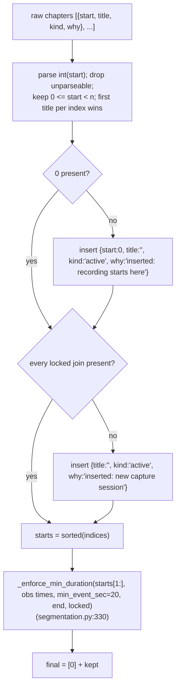
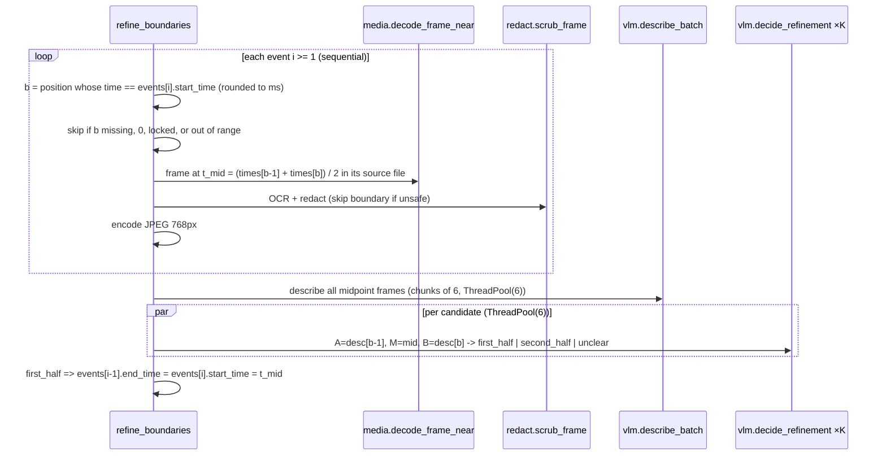

# 05 — Pass 2: coalescing, validation, and boundary refinement

> **Pre-refactor.** This document describes the code at `c39a118`. The pipeline was since unified on branch `refactor/unify-pipeline`; see [12-unified-pipeline.md](12-unified-pipeline.md) for what changed.

Code: `cuts/coalesce.py`, `cuts/refine.py`, the coalescing branch of
`cuts/pipeline.py` (`_run_llm`, line 454).

## 1. Inputs and outputs

```
coalesce(observations, CoalesceConfig, SegmentationConfig,
         video_id, duration_sec, timeline, locked, api_key, verbose)
  -> (List[Event], "llm" | "failed")                              coalesce.py:407
```

- `observations`: time-sorted Pass 1 output (with transcripts if ASR ran).
- `locked`: observation positions that must start a chapter (file joins).
- `SegmentationConfig` is passed only for `min_event_sec`.

Edge cases before any API call:

| Condition | Result |
|-----------|--------|
| `n == 0` | `([], "failed")` → caller falls back (and the fallback also produces nothing) |
| `n == 1` | One event, **empty title**, `"llm"` — no call is made |
| `n > max_observations` (1500) | Prints a warning and proceeds anyway |

## 2. Prompt assembly

`_build_prompt` (`coalesce.py:175`) concatenates, separated by blank lines:

1. If `intent` is set: `What this index is for: <intent>` + an instruction
   to judge chapters against it and to coalesce work that does not serve it.
2. A header: `N observations spanning H:MM:SS of recording.` plus, for
   multi-file timelines, a note that sessions are marked and each must
   start a new chapter.
3. `render_observations` (`coalesce.py:146`), one line per observation:

```text
--- new capture session: day2.mp4 ---          (multi-file only, at each source change)
[17] 8:30  VS Code editing parser.py, implementing tokenize() for string literals
      said: <transcript, first 300 chars>     (only if non-empty)
      screen text: <OCR lines joined by " / ", first 400 chars>   (only with --include-ocr)
```

Descriptions that are empty render as `(frame withheld)` or
`(no description)`. The withheld marker covers both redaction and
decode failure.

The system prompt (`_SYSTEM`, `coalesce.py:60`) instructs the model to return
the indices where a chapter **begins** (first must be 0), to cut on changes
in *activity* rather than window/layout, to prefer fewer meaningful chapters,
and to give each a 2–5 word lowercase `title`, a `kind`
(`pivotal | active | routine | idle`) and a `why` citing evidence.

## 3. The call

`_call_claude` (`coalesce.py:211`): one non-streaming
`client.messages.create` with `model = "claude-opus-5"`, `max_tokens = 16000`,
`output_config = {"effort": "medium", "format": {json_schema: _SCHEMA}}`.
On Claude Opus 5 thinking is on by default, so the 16 000-token budget
covers thinking plus the JSON.

Raises (→ caller returns `"failed"`) on: any SDK exception,
`stop_reason == "refusal"`, `stop_reason == "max_tokens"`, no text block,
or an empty `chapters` list. `json.loads` errors also propagate as
exceptions. No server-side refusal fallback is configured for this call
(labeling has one; see [08](08-llm-integration.md)).

## 4. Validation and repair

The key design decision: the model returns **cut points**, not spans, so
gaps and overlaps are not expressible, and every boundary lands on a real
sample time. `_validate_and_repair` (`coalesce.py:256`) handles the rest:



`_enforce_min_duration` walks boundaries left to right and drops any that is
less than `min_event_sec` after the previously kept one, unless locked; then
drops the last boundary if the final chapter is too short (unless locked).
A dropped boundary merges its chapter into the **previous** one, and the
dropped chapter's title/kind/why are discarded.

Inserted chapters have **empty titles**, which render as `(unlabeled)` in
the CLI chapter list and `(untitled)` in the GUI. Nothing re-titles them.

## 5. Event materialisation

`_events_from_chapters` (`coalesce.py:321`) turns validated starts into
`Event`s. For chapter *k* with members `observations[s:e]`:

| Event field | Value |
|-------------|-------|
| `event_id` | `f"{k:04d}"` |
| `start_frame`, `end_frame` | `-1` (no ordinals on this path) |
| `start_time` | `observations[s].t` |
| `end_time` | `observations[e].t`, or `duration_sec` for the last |
| `title` | model title, stripped |
| `summary` | the model's **`why`** (not a summary) |
| `vlm_text` | distinct descriptions, `\n`-joined (`_dedup`, case-insensitive) |
| `transcript_text` | distinct transcript strings, space-joined |
| `sample_times` | member observation times |
| `sample_indices`, `representative_frames` | empty |
| `representative_times` | up to 3 interior non-withheld times (`_pick_representative_times`) |
| `metadata` | `{kind, n_samples, n_withheld, segmenter: "llm"}` |

The events tile `[first observation t, duration_sec]` with no gaps.

## 6. Fallback when coalescing fails

See [02 §2](02-execution-paths.md#2-the-llm-path-default) and
[06 §4](06-curve-path-labeling-asr.md#4-fallback-segmentation-over-observations).
Summary: curve segmentation over description TF-IDF (no DINO), forced join
boundaries, evidence re-attached from observations, then `label_events`
with `backend="auto"`. Events from this path have no `kind` and
`metadata.segmenter` is absent; `boundary_score` and `n_samples` come from
`segment()`.

## 7. Boundary refinement

`refine_boundaries(events, inp, vlm_texts, timeline, config, locked, api_key)`
(`refine.py:50`) mutates `start_time`/`end_time` in place. It is shared by
the LLM path, the fallback, and the curve path.



Behaviour notes:

- Only `"first_half"` moves a boundary (earlier, to the midpoint);
  `"second_half"` and `"unclear"` leave it. So refinement can only ever move
  a chapter start **earlier**, by exactly half an interval (15 s at
  defaults).
- `sample_times`, `vlm_text` and `representative_times` are not updated;
  after a move, an event's `start_time` is earlier than its first
  `sample_times` entry.
- Boundary positions are found by matching `round(start_time, 3)` against
  `round(times[i], 3)`, which works because both come from the same
  observation times.
- The decision model is `refine.model or vlm.model` (Haiku 4.5),
  `max_tokens=100`, structured output with an enum.
- Midpoint frames from **unrelated boundaries** are batched six per
  describe call, but `_DESCRIBE_SYSTEM` tells the model they are
  "consecutive frames from one recording" and to use neighbours for context.
  See [11-findings.md §1.6](11-findings.md#16-refinement-batches-unrelated-frames-as-consecutive).
- `decode_frame_near` uses `timeline.local_time(t_mid)`, so its correctness
  depends on the timeline offsets matching the observation times (see
  findings §1.5 for when they do not).
- Phase 1 (decode + OCR + redact + encode) is sequential per boundary.
