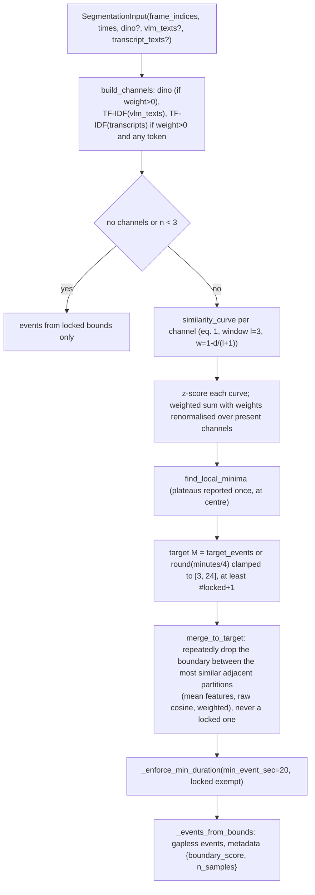

# 06 — Curve segmentation, labeling, ASR, and query selection

> **Pre-refactor.** This document describes the code at `c39a118`. The pipeline was since unified on branch `refactor/unify-pipeline`; see [12-unified-pipeline.md](12-unified-pipeline.md) for what changed.

Code: `cuts/segmentation.py`, `cuts/signals/dino.py`,
`cuts/signals/text_features.py`, `cuts/labeling.py`, `cuts/signals/asr.py`,
`cuts/select.py`.

## 1. Signals for the curve path

### DINOv2 (`signals/dino.py`)

- Model: `facebook/dinov2-small` via `transformers.AutoModel` +
  `AutoImageProcessor`, loaded once per `(model, device)` into a module
  global (`dino.py:37`). Device is `CutsConfig.device` (CUDA → MPS → CPU,
  `config.py:38`) unless `dino.device` is set.
- `embed_stream` (`dino.py:84`) converts BGR→RGB, runs batches of 16 under
  `torch.no_grad()`, takes the CLS token (`last_hidden_state[:, 0]`) or the
  patch-token mean, L2-normalises, returns `(N, 384)` float32.
- The pipeline resizes frames to a 448 px long edge first
  (`SamplingConfig.frame_long_edge`), then the HF processor applies its own
  resize/crop.
- `embed_frames`, `cosine_similarity_matrix` and `dino.adjacent_similarity`
  are only used by debug code or not at all.

### TF-IDF (`signals/text_features.py`)

`text_features(texts, max_vocab=20000, min_df=1)` (`text_features.py:44`):
alnum/underscore tokens, lowercased; vocabulary = top `max_vocab` terms by
document frequency; smoothed IDF `log(1 + N / (1 + df))`; sublinear TF
`1 + log(tf)`; rows L2-normalised; empty strings give zero rows. Returns
`(N, 0)` when there are no tokens at all. This is a dense `N × V` float32
matrix — at 20 000 terms and a few thousand samples that is tens to hundreds
of MB.

## 2. EFS Stage 1 segmentation (`segmentation.py`)

`segment(inp, config, video_id, duration_sec, verbose, forced_bounds)`
(`segmentation.py:386`). Implements Stage 1 of arXiv 2603.00983 generalised
to several channels.

Implementation notes:

- `similarity_curve` (`segmentation.py:85`) averages weighted cosine to
  neighbours within `l` on each side, normalising by the realised weight sum
  so edges are not depressed. Low = candidate boundary.
- A flat channel (std < 1e-8) z-scores to zeros and contributes nothing.
- `merge_to_target` (`segmentation.py:292`) recomputes all partition means
  every iteration: O(iterations × N × D). With hundreds of minima and a
  20k-wide TF-IDF channel this is the curve path's main CPU cost after
  decoding.
- Events store `sample_indices` as *frame indices* (not positions);
  `pipeline._attach_evidence` maps them back to positions
  (`pipeline.py:672`). In the fallback path, "frame indices" are positions
  by construction.
- `event_id` uses the loop index *k* over starts, so ids are contiguous only
  because no partition is ever empty after merging.

### Evidence attachment on the curve path

`_attach_evidence` (`pipeline.py:660`) sets `vlm_text` (deduplicated
descriptions, after carry-forward), `transcript_text` (deduplicated aligned
transcript strings) and `representative_frames` (3 interior sample frame
indices). `representative_times` is not set, so labeling decodes by frame
index on this path.

## 3. Labeling (`labeling.py`)

`label_events(events, source, LabelingConfig, backend, api_key, verbose,
ocr_config, redact_config) -> "claude" | "heuristic" | "none"`
(`labeling.py:453`). Mutates `title` in place.

Called from: the curve path (`pipeline.py:430`), the coalescing fallback
(`pipeline.py:613`), `cuts label` (`cli.py:441`), and the module's own
`__main__`. Not called on a successful LLM path (titles come from coalescing).

Backend resolution: `"auto"` → `"claude"` if `api_key` or
`ANTHROPIC_API_KEY` is set, else `"heuristic"`. A failed Claude call
(any exception) falls back to heuristic with a printed message.

### Claude backend

1. **Frames** (`_encode_frames`, `labeling.py:228`; skipped when
   `frames_per_event == 0`): `_decode_representatives` picks
   `frames_per_event` (2) frames per event —
   by time via `iter_frames_at_times` when the event has
   `representative_times` (LLM/fallback events), else by frame index via
   `decode_frames_at` (curve events; linear decode up to the last index).
   Each frame goes through `scrub_frame` (unsafe frames are dropped), then
   is resized to 768 px and JPEG-encoded at quality 80. Redaction defaults
   to **on** when the caller passes no configs.
2. **Content** (`_build_content`, `labeling.py:297`): a preamble (with a
   multi-session note), then per event a text block
   `[event_id] start-end (Ns)` + `on-screen descriptions:` (≤1500 chars) +
   `transcript:` (≤1500 chars), followed by its images.
3. **Call** (`_call_claude`, `labeling.py:339`): `claude-opus-5`,
   `max_tokens=8000`, `effort=medium`, JSON schema
   `{"chapters":[{"event_id","title"}]}`. With `use_fallbacks` it uses
   `client.beta.messages.create(betas=["server-side-fallback-2026-07-01"],
   fallbacks="default", ...)`, retrying without the beta on
   `BadRequestError`. Refusal or `max_tokens` raise.
4. Titles are matched back by `event_id`; unmatched events get `""`.

All events go into a single request. `LabelingConfig.batch_all_events`
suggests a per-event mode exists; it does not — the field is never read.

### Heuristic backend

`_heuristic_labels` (`labeling.py:410`): tokenise `combined_text`
(descriptions + transcript), drop short tokens, digits and a small stopword
list, score each term by `count × N / (1 + document_frequency_across_events)`,
and join the top three terms. Events with no tokens are titled `"unclear"`.

## 4. Fallback segmentation over observations

`_fallback_curve` (`pipeline.py:580`) is the curve algorithm applied to
Pass 1 output when coalescing fails:

- `SegmentationConfig` copied with `weight_dino = 0`; VLM weight 0.5 and
  ASR weight 0.0 remain, so in practice only the description TF-IDF channel
  drives it.
- `frame_indices = range(n)` so events' `sample_indices` are observation
  positions; `_attach_observation_evidence` (`pipeline.py:621`) then
  converts them to times and clears the indices.
- Labeling runs with `backend="auto"` regardless of `--backend`.

## 5. ASR (`signals/asr.py`)

- `transcribe(path, ASRConfig, device)` (`asr.py:50`): returns `[]` if
  disabled, no audio stream, or `faster_whisper` is not importable.
  Otherwise loads `WhisperModel` (`base` by default; float16 on CUDA, int8
  on CPU; falls back to CPU if CUDA init fails), cached per
  `(model, device)`, and transcribes the **whole file** with VAD.
  Exceptions from `model.transcribe` itself are **not** caught and abort the
  run.
- `align_to_samples(segments, sample_times, window_sec=0)` (`asr.py:89`):
  one sweep; each sample gets the space-joined text of every segment whose
  `[start, end]` covers it. At a 30 s interval, speech between samples is
  **not** captured — only segments that happen to span a sample instant.
- Both paths run ASR per audible source, shift segment times by
  `source.time_offset`, and align. On the curve path transcripts become a
  (zero-weight by default) channel and labeling evidence; on the LLM path
  they appear as `said:` lines in the coalescing prompt.
- Sources are transcribed sequentially; ASR does not overlap with any other
  stage.

## 6. EFS Stages 2–3 (`select.py`) — implemented, never called

`select.py` implements query-driven anchor selection
(`select_anchors`, line 123) and adaptive MMR with strict→loose
thresholds (`adaptive_mmr`, line 145), using open-clip ViT-B-32 for
query-frame relevance (`clip_relevance`, line 80) instead of the paper's
BLIP2-ITM. No module imports it, no CLI command reaches it, and `open_clip`
is not a declared dependency. It operates on frame embeddings and sample
positions, i.e. the curve path's data shapes, and has no adapter for
LLM-path observations (which carry no embeddings).
