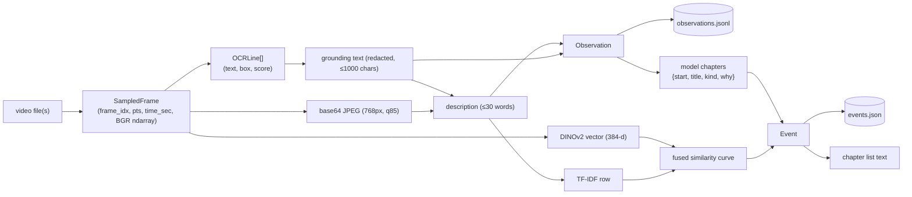

# 07 — Data model and on-disk formats

## 1. In-memory types and how data is transformed



### `SampledFrame` (`cuts/media.py:76`)

| Field | Type | Notes |
|-------|------|-------|
| `frame_idx` | int | decode ordinal; `-1` for seeked frames |
| `pts` | int | stream time-base units |
| `time_sec` | float | `pts * time_base`; global on the curve path, local in Pass 1 |
| `image` | ndarray HxWx3 BGR uint8 | mutated in place by redaction |

### `Observation` (`cuts/observe.py:79`)

| Field | Type | Notes |
|-------|------|-------|
| `t` | float | global seconds; the **requested** grid time, not the decoded frame's pts |
| `source_index` | int | index into the timeline's sources |
| `source_time` | float | `t` within its own file |
| `description` | str | VLM sentence; `""` on any failure or when withheld |
| `ocr_text` | str | redacted grounding text, `\n`-joined, truncated |
| `transcript_text` | str | set in memory after Pass 1; **never persisted** in the cache |
| `redacted` | List[str] | pattern names that matched (never content) |
| `withheld` | bool | not described: undecodable **or** unsafe |

### `Event` (`cuts/schema.py:48`)

| Field | LLM path | Curve path | Fallback |
|-------|----------|-----------|----------|
| `video_id` | first stem (`+N`) | same | same |
| `event_id` | `"0000"`… | same | same |
| `start_frame`, `end_frame` | -1 | global frame idx | -1 |
| `start_time`, `end_time` | obs times (start may be moved by refine) | sample times | obs times |
| `title` | from coalescing | from labeling | from labeling |
| `summary` | the model's **`why`** | "" | "" |
| `vlm_text` | dedup descriptions | dedup carried-forward descriptions | dedup descriptions |
| `transcript_text` | dedup aligned text | same | same |
| `sample_times` | set | **empty** | set |
| `sample_indices` | empty | frame indices | cleared |
| `representative_times` | ≤3 | empty | ≤3 |
| `representative_frames` | empty | ≤3 frame indices | empty |
| `source_path/index/start_time` | `_attach_sources` | same | same |
| `metadata` | `kind, n_samples, n_withheld, segmenter="llm"` | `boundary_score, n_samples` | `boundary_score, n_samples` |

The `Event` docstring (`schema.py:76-82`) calls `sample_times` "the
canonical membership record", but the curve path never sets it. Its
`metadata` docs list `merged_from`, which nothing writes, and omit `kind`,
`n_withheld` and `segmenter`.

`Event.from_dict` drops unknown keys, so readers tolerate newer writers.

### `PipelineResult` (`cuts/pipeline.py:56`)

Run summary: `video_id, video_path, duration_sec, n_samples, events,
channels_used, label_backend, runtime_sec, stage_times, timeline, segmenter,
redacted_frames, withheld_frames`. Only the CLI consumes it. On the curve
path `segmenter` keeps its default `"curve"`; on the LLM path
`label_backend` holds the coalescing outcome.

## 2. `events.json`

Written by `write_events` (`cuts/schema.py:179`): `mkstemp` in the target
directory, `json.dump(indent=2, ensure_ascii=False)`, `os.replace`.

```jsonc
{
  "video_id": "session",                 // "session+2" for 3 files; "<stem>.events" when written by `cuts coalesce`
  "video_path": "/abs/session.mp4",      // first source
  "duration_sec": 5232.1,
  "sources": [
    {"path": "/abs/session.mp4", "index": 0, "duration_sec": 5232.1,
     "time_offset": 0.0, "frame_offset": 0, "frame_span": 0}
  ],
  "events": [ { ...Event.to_dict()... } ],
  "extra": {                             // present when written by `chapters` / `coalesce`
    "n_samples": 174, "channels": ["vlm"], "segmenter": "llm",
    "intent": "", "label_backend": "llm",
    "stage_times": {"observe": 480.2, "coalesce": 41.0, "refine": 12.3}
  }
}
```

`read_events` (`schema.py:224`) synthesises a one-source `sources` list for
indexes written before multi-file support. `cuts label` rewrites the file
**without** `extra`. `cuts coalesce` writes `extra` with `n_observations`
instead of `n_samples`; the GUI reads either.

Default location: beside the first video, `<stem>.events.json` or
`<stem>+N.events.json`. Matched by the `*.events.json` rule in `.gitignore`.

## 3. `observations.jsonl`

Written by `write_observations` (`cuts/observe.py:409`) via `<path>.tmp` +
`os.replace`.

```jsonc
{"_meta": {"version": 1, "files": [["/abs/a.mp4", 1759600000, 734003200]],
           "interval_sec": 30.0, "redact": true, "ocr": true,
           "vlm_model": "claude-haiku-4-5"}}
{"t": 0.0, "source_index": 0, "source_time": 0.0,
 "description": "VS Code with parser.py open, writing a tokenize() function for string literals",
 "ocr_text": "parser.py\ndef tokenize(src):\n...", "transcript_text": "",
 "redacted": [], "withheld": false}
...
```

`read_observations` (`observe.py:428`) accepts the header anywhere, ignores
blank lines, and sorts by `t`. `transcript_text` is always `""` on disk.

Privacy note (also in `.gitignore`): every observation stores the OCR text of
that frame, so the file is effectively a transcript of the screen. OCR text is
post-redaction but redaction is best-effort.

## 4. Chapter list text

`to_chapter_list(events, show_source)` (`cuts/schema.py:245`):

```text
0:00 writing parser
7:32 compiling
1:04:11 debugging segfault      [day-2.mp4 @ 4:11]     <- show_source (multi-file)
```

Empty titles render as `(unlabeled)`. The GUI re-implements this function
(`cuts_gui/backend.py:418`), byte-compatible by intent.

## 5. GUI state files

| File | Writer | Contents |
|------|--------|----------|
| `<AppData>/library.json` (`QStandardPaths.AppDataLocation`) | `cuts_gui/library.py:95` | `{"version": 1, "sessions": [Session.to_dict()...]}` — name, files, index_path, RunSettings, status, message, redaction_warning, duration, id |
| QSettings `backend/python`, `backend/root` | `cuts_gui/dialogs.py:521` | Interpreter and backend folder overrides (empty = default) |

## 6. The config tree

`CutsConfig` (`cuts/config.py:462`) aggregates one dataclass per stage:
`SamplingConfig, ObserveConfig, DinoConfig, VLMConfig, OCRConfig,
RedactConfig, ASRConfig, SegmentationConfig, CoalesceConfig, RefineConfig,
LabelingConfig, SelectConfig, SearchConfig` plus `device`, `segmenter`,
`cache_dir`, `verbose`. Instances are plain mutable dataclasses passed by
reference (and pickled to worker processes under `--executor process`).
`_fallback_curve` copies `SegmentationConfig` with `SegmentationConfig(**vars(...))`
before mutating it; elsewhere the CLI mutates the instance it built.
See the table in [01 §6](01-overview.md#6-configuration-surface-in-one-table)
for which knobs are honoured where.
