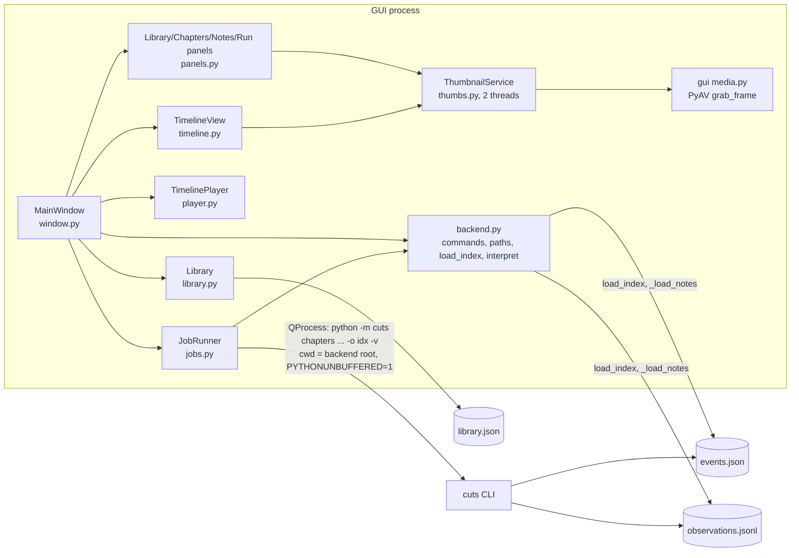
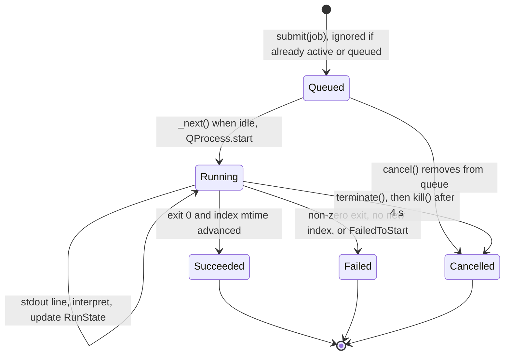

# 09 — The desktop GUI (`cuts_gui`)

`cuts_gui` is a PySide6 application (`python -m cuts_gui [videos-or-indexes]`)
for adding recordings, running analyses, and navigating results with a
video player and a multi-lane timeline.

## 1. The process boundary

The GUI **never imports `cuts`**. It runs the backend as a subprocess and
reads the files it writes. All knowledge of the CLI, the on-disk formats and
the log format is confined to `cuts_gui/backend.py`; the rest of the GUI is
written against its own types in `cuts_gui/model.py`.

Consequences of the design: torch/ONNX/Whisper never load into the UI
process; cancelling is killing a process; and the GUI's correctness depends
only on the CLI flags, the JSON formats, and (for display only) log lines.

## 2. `backend.py` — the adapter

| Function | Line | Role |
|----------|------|------|
| `default_root()` | 55 | Repo root if `cuts/__main__.py` sits beside `cuts_gui`, else cwd. Used as the subprocess cwd so `.env` discovery matches a terminal run. |
| `credentials_source(root)` | 74 | `"environment"`, a `.env` path, or `""`. Mirrors dotenv's "first `.env` walking up wins". Never returns the key. |
| `Backend.analyze_command(session)` | 119 | `python -m cuts chapters <files> -o <index> -v` + flags for each non-default `RunSettings` field. |
| `Backend.rechapter_command(session, settings)` | 148 | `python -m cuts coalesce <notes> -o <index> -v` + intent/min-chapter/include-ocr/model. Returns `None` if no matching notes file. |
| `default_index_path(files)` | 181 | Mirrors `cli._default_out_path`. |
| `_notes_candidates` / `find_notes` / `_notes_match` | 193 / 212 / 220 | Locate an observation cache for the session, matching on **basename + size** of each file (the backend matches on absolute path + mtime + size). |
| `load_index(session)` | 286 | Reads `events.json` (+ notes) into `model.Index`. Prefers the session's own file list over paths recorded in the index; resolves moved files by looking beside the index. |
| `chapter_list(index, show_source)` | 418 | Re-implementation of `cuts.schema.to_chapter_list`. |
| `STAGES`, `_RULES`, `interpret(line)` | 450 / 484 / 531 | Regex mapping of backend log lines to `Signal(kind, stage, text, value)`. |

### Log interpretation

`interpret` tries each rule in order and returns the first non-`None`
signal. Stage keys are the GUI's own (`observe`, `transcribe`, `chapter`,
`refine`, `label`); the timing lines that `pipeline._mark` prints
(`"  [observe] 233.7s"`) become `done` signals via the `_TIMED` map. Other
rules recognise cache reuse, shard counts, ASR, coalescing progress, curve
segmentation, refinement, labeling, redaction warnings, the fallback and
no-key warnings, any line containing `WARNING`, `error: …`, a Python
traceback header, and the final `index: <path>` line.

Success is **not** decided by log parsing: `JobRunner._done` requires a
normal exit, exit code 0, no cancellation, and the index file's mtime to have
advanced (`cuts_gui/jobs.py:239-244`).

## 3. `JobRunner` — one job at a time

- Strictly serial (deque + one `QProcess`), justified in the module
  docstring by Pass 1 already saturating the CPU.
- Output channels are merged; `\r` is normalised so carriage-return progress
  lines split correctly.
- `RunState.log` is capped at 5 000 lines by trimming the front
  (`jobs.py:217-218`). `RunPanel.show_state` appends `st.log[self._lines_shown:]`
  and only resets when `_lines_shown > len(st.log)`; once the cap is hit
  both are 5 000, so the Run panel **stops showing new lines** for the rest
  of that run (`panels.py:868-878`).
- `shutdown()` kills the running process on window close.

## 4. Library and session lifecycle

`Library` (`library.py:25`) persists `Session`s to
`<AppData>/library.json` with atomic writes on every change. On load,
`RUNNING`/`QUEUED` sessions become `CANCELLED` ("interrupted"), and status is
reconciled with whether the index file exists.

`Session.status` transitions are driven by `MainWindow`:
`NEW → QUEUED (_submit) → RUNNING (_on_job_started) → READY | FAILED |
CANCELLED (_on_job_finished)`. A redaction warning seen in the run's log is
stored on the session (`redaction_warning`) and shown as a sticky banner
until dismissed.

`AddVideosDialog` lets the user order files (natural sort, move up/down) and
choose between "separate recordings" and "one recording split across
files"; the latter creates a single multi-file `Session`.

## 5. Viewing results

- **`load_index`** builds `Index(title, duration, sources, chapters, notes,
  notes_unavailable, facts)`. `Chapter.reason` is the event's `summary`
  (i.e. the coalescing model's `why`). `Note`s come from the observation
  cache if one matches; otherwise `notes_unavailable` explains why (e.g.
  curve-path indexes have no notes).
- **`TimelinePlayer`** (`player.py:20`) wraps one `QMediaPlayer`; it maps
  global seconds to (file, local seconds), loads the right file on seek,
  defers the seek until the media is loaded, and rolls over to the next
  file at end of media.
- **`TimelineView`** (`timeline.py:68`) paints lanes directly: ruler +
  overview, files (multi-file only), chapters coloured by `kind`, note ticks
  (red = redacted, hollow = withheld), and a filmstrip of thumbnails on a
  zoom-dependent grid. Supports scrub, pan, zoom around the pointer,
  double-click to zoom to a chapter.
- **`ThumbnailService`** (`thumbs.py:54`): newest-first stack of at most 48
  pending requests, 2 `QThreadPool` workers, LRU cache of 800 `QImage`s,
  failed keys remembered. Each request opens the video, seeks and decodes —
  there is no shared decoder.
- **`NotesPanel`** lists notes with a text filter over
  description/OCR/transcript and a "flagged" filter (redacted or withheld).
  Thumbnails of redacted notes are **pixelated until clicked**, because the
  GUI decodes from the local, unredacted video (`panels.py:728-745`). The
  timeline filmstrip draws the same frames **without** this protection
  (`timeline.py:547-575`).
- **Re-chapter** (`window.py:731`) runs `cuts coalesce` over the cached
  notes with a new intent. The dialog states that this skips refinement and
  transcripts, which matches the backend's behaviour.

## 6. Discrepancies between GUI messaging and backend behaviour

| GUI says | Backend actually does |
|----------|-----------------------|
| "No ANTHROPIC_API_KEY … Analysis will still run, but on the visual channel only, with rough keyword titles." (`dialogs.py:197-203`) | True only for `--segmenter curve`. The default LLM path produces one "unclear" chapter per file and caches empty descriptions. |
| "Show in Finder" menu items | On non-macOS platforms opens the containing folder (`window.py:772-775`). Label is macOS-specific. |
| Settings "Python" defaults to the GUI's own interpreter | That interpreter must also have the backend's heavy dependencies; the GUI venv and the backend venv are assumed identical. |
| Re-chapter enabled for READY sessions in the library context menu (`panels.py:251`) | `MainWindow.rechapter` then reports there are no notes for curve-path indexes; harmless. |

## 7. Dependencies

`PySide6` (Widgets, Multimedia, MultimediaWidgets) and optionally `av` (for
durations, thumbnails). PySide6 is not declared in `pyproject.toml` or
`requirements.txt`, and is not installed in the local `.venv`.
