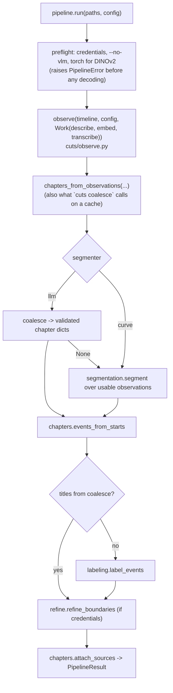
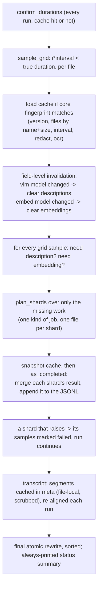

# 12 — The unified pipeline (branch `refactor/unify-pipeline`)

Documents 02–10 describe the code at `c39a118`, before this refactor. This
document describes what changed and how the system works now. Where they
disagree, this one is current. The findings it resolves are tracked in
[11-findings.md](11-findings.md#resolution-status).

## 1. One pipeline

Before, `pipeline.run()` held two pipelines: the LLM path (seek-based,
sharded, cached Pass 1 → one coalescing call) and an inline curve path with
its own sequential decode loop, streaming VLM executor, stride and
backpressure logic, and a copy of the ASR code. A third variant,
`_fallback_curve`, glued the two together. Now there is one:



| Module | Role now |
|--------|----------|
| `cuts/llm.py` (new) | The only place that talks to Claude: `has_credentials()` (asks the SDK, so profiles count), one shared client, a global `BoundedSemaphore` (`LLMConfig.max_concurrency`, default 8) around every request, and `structured_call()`, which raises `LLMError` on SDK error, refusal, `max_tokens`, missing text or non-JSON. |
| `cuts/observe.py` | Pass 1 for both segmenters. Resumable cache, per-observation `status`, optional DINOv2 embedding, transcript. |
| `cuts/chapters.py` (new) | `join_positions`, `enforce_min_duration`, `events_from_starts`, `attach_sources`, shared by both segmenters. |
| `cuts/coalesce.py` | Returns validated chapter dicts (`start`, `title`, `reason`, `metadata.kind`) or `None`. |
| `cuts/segmentation.py` | Returns a `Segmentation(bounds, fused, channels)` built from observations; `snap_to_cuts` places each dip on the sharpest adjacent pair. |
| `cuts/pipeline.py` | `preflight`, `run`, `chapters_from_observations`. 303 lines, down from 700. |

Removed: the inline curve loop, `_run_llm`, `_fallback_curve`,
`_attach_evidence`, `_attach_observation_evidence`, `media.iter_timeline_frames`,
`media.decode_frames_at`, `media.build_frame_index`, `media.get_fps`,
`vlm.describe_image`, `vlm.carry_forward` (moved to segmentation),
`dino.embed_frames`/`cosine_similarity_matrix`/`adjacent_similarity`,
`cuts/select.py`, `SelectConfig`, `SearchConfig`, `CutsConfig.cache_dir`,
`VLMConfig.stride`/`concurrency`/`max_inflight_chunks`,
`LabelingConfig.batch_all_events`, the `api_key` parameter everywhere, and the
`--vlm-stride` flag.

## 2. Pass 1 now



`Observation.status` is one of `ok`, `failed` (a description was requested
but not obtained; retried next run), `withheld` (a credential could not be
painted over; never uploaded), or `undecodable` (no frame within tolerance).
`describe_frames` returns `None`, not `""`, for frames it could not describe.

`observe_shard` does OCR and redaction only when it will upload, embeds every
decoded frame (withheld ones included, since embedding is local) when asked,
and consumes `iter_frames_at_times` as a generator, so a shard holds one
full-resolution frame at a time.

Cache format (version 2):

```jsonc
{"_meta": {"version": 2, "files": [["session.mp4", 734003200]],
           "interval_sec": 30.0, "redact": true, "ocr": true,
           "sources": [{"path": "...", "index": 0, "duration_sec": 5232.1, "time_offset": 0.0}],
           "vlm_model": "claude-haiku-4-5", "embed_model": null,
           "asr": {"model": "base", "segments": [[0, 12.0, 15.5, "..."]]}}}
{"t": 0.0, "source_index": 0, "source_time": 0.0, "status": "ok",
 "description": "...", "ocr_text": "...", "transcript_text": "", "redacted": []}
```

Readers take the last line per `(source_index, source_time)` and skip
unparseable lines, because the file is appended to while a run is in
progress. Multi-file caches are named `<first_stem>+N.observations.jsonl`,
like their index.

## 3. Index format changes

- `Event` dropped `start_frame`, `end_frame`, `sample_indices`,
  `representative_frames`, and `summary`. It gained `reason` (the coalescing
  model's justification). `Event.from_dict` maps a legacy `summary` to
  `reason`.
- `sources[]` dropped `frame_offset` and `frame_span`.
- `extra` now records `segmenter` (`llm`, `curve`, or `llm->curve`),
  `titles` (`llm`, `claude`, `heuristic`, or `none`) and `samples` (counts by
  status). `label_backend` is gone; the GUI reads either key.
- `cuts label` keeps `extra`, updating only `titles`.

## 4. Behaviour changes users will notice

| Before | Now |
|--------|-----|
| Default run without credentials ran to completion, cached empty descriptions, and produced one "unclear" chapter per file | Exits 2 with `error: no Anthropic credentials found ...` before decoding |
| A failed description call was cached as `""` forever | Recorded as `failed`, retried on the next run, counted in an always-printed summary |
| A crashed shard or Ctrl-C lost all of Pass 1 | Finished shards are on disk; the next run does only what is missing |
| `--no-labels` disabled coalescing and triggered a "coalescing failed" fallback | Only skips the separate titling call for curve chapters |
| `cuts coalesce`: no transcript, no refinement, no fallback, different `video_id`, header durations | Same post-Pass-1 code as `chapters`; timeline rebuilt from the cache's confirmed `sources` |
| Curve path: separate sequential decode, VLM only on every *stride*-th frame | Same seek-based Pass 1 and cache; DINOv2 embeddings cached per observation |
| Refinement batched unrelated midpoints as "consecutive" frames | One midpoint per describe call |
| Spoken credentials went to the prompts unscanned | Transcript segments pass through `redact.scrub_text` |
| Curve boundaries landed one sample early on about half of clean cuts | `snap_to_cuts` puts each boundary on the first sample after the cut |

## 5. Repository hygiene

The working tree holds only the codebase and ignored run output. Removed:
the `OmniShotCut/` clone, its `checkpoints/` weights, stale `cuts.egg-info/`,
and directories under `cuts/` that held only orphaned bytecode. Everything the
tool writes is ignored: `*.events.json` (+ `.events_*.json` temp files),
`*.observations.jsonl` (+ `.tmp`), and GUI-saved `*.chapters.txt`; so is the
output of earlier versions (`retrieval_index/`, `refine_experiment/`,
`dummy.json`), which is kept on disk. The observation cache warrants ignoring
on privacy grounds as well as size: it holds the OCR text and the speech
transcript of the recording.

## 6. Tests

`tests/` (pytest, no network): `conftest.py` encodes small h264 fixtures with
PyAV, and provides `FakeClient`, which answers describe, coalesce, label and
refine requests from the request contents (descriptions are derived from the
uploaded JPEG's colour). It can be scripted to fail with an error, refusal,
`max_tokens` or bad JSON. An autouse fixture makes the real client unusable,
so no test can reach the API. `fake_dino` stands in for DINOv2. 55 tests cover
validation, the event builder, Pass 1 resume/retry/upgrade, redaction of
pixels, grounding text and speech, the shared LLM error paths, both
segmenters, the fallback, the CLI commands, and the GUI adapter plus an
offscreen main-window smoke test.
