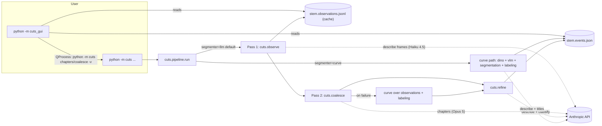

# CUTS — Architecture Documentation

This directory describes how the CUTS codebase **actually works**. Documents
01–11 are a read-only trace of every source file at commit `6c551be`
("events coalescing, optimizations, and gui v1"). The pipeline was then
unified on branch `refactor/unify-pipeline`:
**[12-unified-pipeline.md](12-unified-pipeline.md) describes the current
architecture**, and [11-findings.md](11-findings.md#resolution-status) tracks
how each finding was resolved. Where the
code and the top-level [README](../../README.md) or in-code docstrings
disagree, these documents follow the code and point out the disagreement.

All `file:line` references are relative to the repository root and were
checked against that commit.

## What CUTS is, in one paragraph

CUTS takes one or more long screen recordings (typically coding sessions) and
produces a **chapter list**: timestamped, titled spans such as
`9:11 debugging segfault`. The default path samples one frame every 30 s,
runs local OCR on each frame, blacks out anything that looks like a
credential, asks a small Claude vision model for a one-sentence description
of each frame (**Pass 1, "observe"**, cached to disk), then sends every
description to a large Claude model in a single structured-output call that
returns chapter cut points and titles (**Pass 2, "coalesce"**). An older,
deterministic path (`--segmenter curve`) instead fuses DINOv2 image
embeddings and TF-IDF text vectors into a similarity curve and cuts at its
minima. A PySide6 desktop GUI (`cuts_gui`) drives the CLI as a subprocess and
visualises the results.

## Reading order

| # | Document | Read it for |
|---|----------|-------------|
| 1 | [01-overview.md](01-overview.md) | Repository layout, packages, dependencies, environment, entry points, module dependency graph |
| 2 | [02-execution-paths.md](02-execution-paths.md) | Every command end to end: `chapters` (LLM and curve paths), `observe`, `coalesce`, `label`, `probe`, plus fallbacks |
| 3 | [03-media-and-sampling.md](03-media-and-sampling.md) | PyAV decoding, seek-based vs sequential sampling, multi-file timelines, duration probing |
| 4 | [04-pass1-observe.md](04-pass1-observe.md) | Sharding, OCR, credential redaction, VLM frame descriptions, the observation cache |
| 5 | [05-pass2-coalesce-refine.md](05-pass2-coalesce-refine.md) | The coalescing call, validation/repair, event materialisation, boundary refinement |
| 6 | [06-curve-path-labeling-asr.md](06-curve-path-labeling-asr.md) | DINOv2, TF-IDF, the EFS similarity curve, labeling, ASR, and the unused `select` module |
| 7 | [07-data-model-and-formats.md](07-data-model-and-formats.md) | `Observation`, `Event`, `Timeline`, on-disk formats, the config tree |
| 8 | [08-llm-integration.md](08-llm-integration.md) | Every Claude API call: prompts, schemas, models, failure handling. Also: the state of "agentic" functionality |
| 9 | [09-gui.md](09-gui.md) | `cuts_gui`: process boundary, job runner, log parsing, library, player, timeline |
| 10 | [10-concurrency-caching-errors.md](10-concurrency-caching-errors.md) | Cross-cutting view of threads, pools, caches and failure modes |
| 11 | [11-findings.md](11-findings.md) | **Bugs, incomplete features, dead code, inconsistencies, bottlenecks, technical debt**, ranked — with their resolution status |
| 12 | [12-unified-pipeline.md](12-unified-pipeline.md) | **The current architecture** after the refactor: one pipeline, resumable Pass 1, shared LLM layer, format changes, tests |

If you only have half an hour, read 01, 12 and 11.

## System at a glance

## Glossary

| Term | Meaning in this codebase |
|------|--------------------------|
| **Sample** | One frame decoded at a point on the sampling grid (default every 30 s). |
| **Observation** | Pass 1's output for one sample: time, OCR text, one-sentence description, redaction flags (`cuts/observe.py:79`). The GUI calls it a **Note**. |
| **Shard** | A contiguous slice of one source file's sample grid, processed independently (`cuts/observe.py:113`). |
| **Event** | A contiguous span of the timeline (`cuts/schema.py:48`). The GUI calls it a **Chapter**. |
| **Timeline / Source** | Several input files laid end to end as one global time axis (`cuts/media.py:302`, `:347`). |
| **Join** | The boundary between two source files; always forced to be a chapter boundary unless `--no-join-boundaries`. |
| **VLM channel** | Per-frame Claude vision descriptions (`cuts/signals/vlm.py`). |
| **Grounding / OCR** | Local RapidOCR text passed into the VLM prompt; not a segmentation signal (`cuts/signals/ocr.py`). |
| **Redaction** | Regex match on OCR lines + black fill of their boxes before any upload (`cuts/redact.py`). |
| **Withheld** | An observation with no description: either redaction could not localise a secret, OCR failed with redaction on, **or** no frame decoded at that time. |
| **Curve path** | The EFS-paper similarity-curve segmenter (`cuts/segmentation.py`), selected with `--segmenter curve`, and also the fallback when coalescing fails. |
| **Refinement** | One bisection step per boundary using a midpoint frame (`cuts/refine.py`). |
| **Intent** | Free text describing what the index is for; injected first into the coalescing prompt. |
